# BLE Floorplan

[](#installation)

A Home Assistant integration that places Bluetooth Low Energy trackers on a floor plan of your home. It takes the signal strength that every Bluetooth scanner of Home Assistant reports for a tracker, turns it into distances and computes a position by trilateration. Each tracker gets a *Room* sensor and a presence tracker. A page in the sidebar, for administrators only, sets everything up; a dashboard card shows the plan with the trackers moving live.

What it is for, for example:

- see on a dashboard in which room the key tag, the phone or the watch is;
- a person counts as home while a scanner hears their phone, with the *Presence* tracker;
- an automation follows a tracker from room to room through Home Assistant's areas;
- play back where a tag was over the last days, on the plan;
- get notified when a Bluetooth proxy goes quiet.

## Screenshots

The page with the plan, the trackers where the scanners hear them, and the floor plan as YAML; everything made up for these pictures:

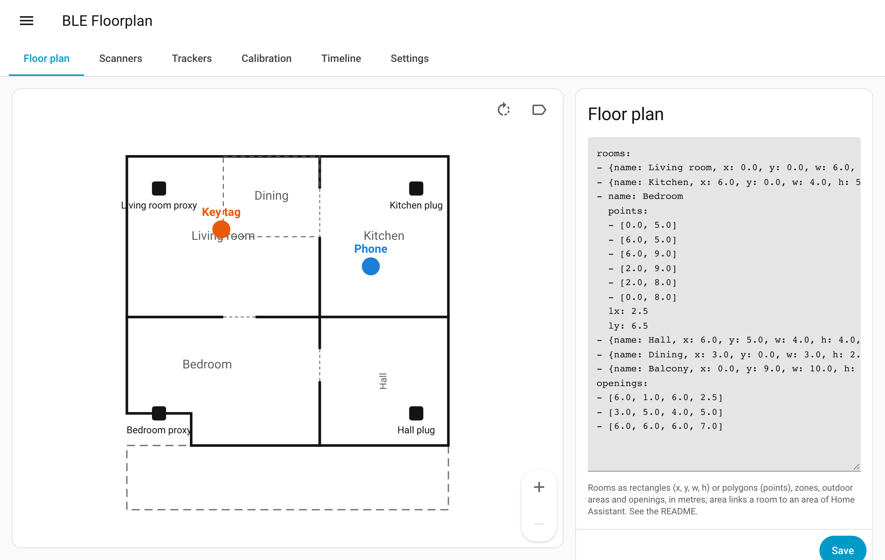

A tracker opens as a subpage: its distance circles on the plan, the distance and signal strength at every scanner:

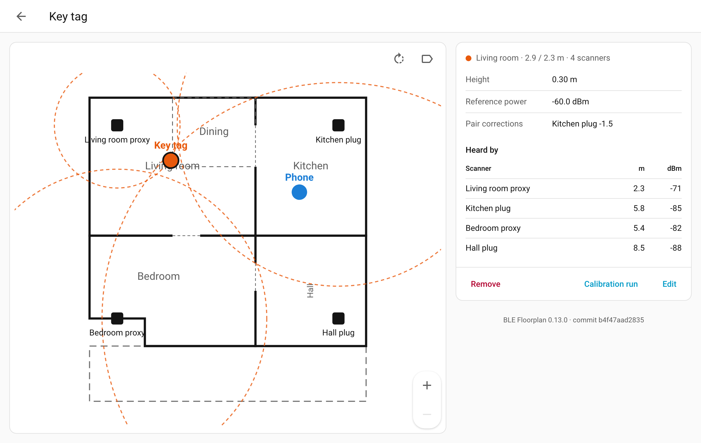

A scanner, with what it hears from every tracker:

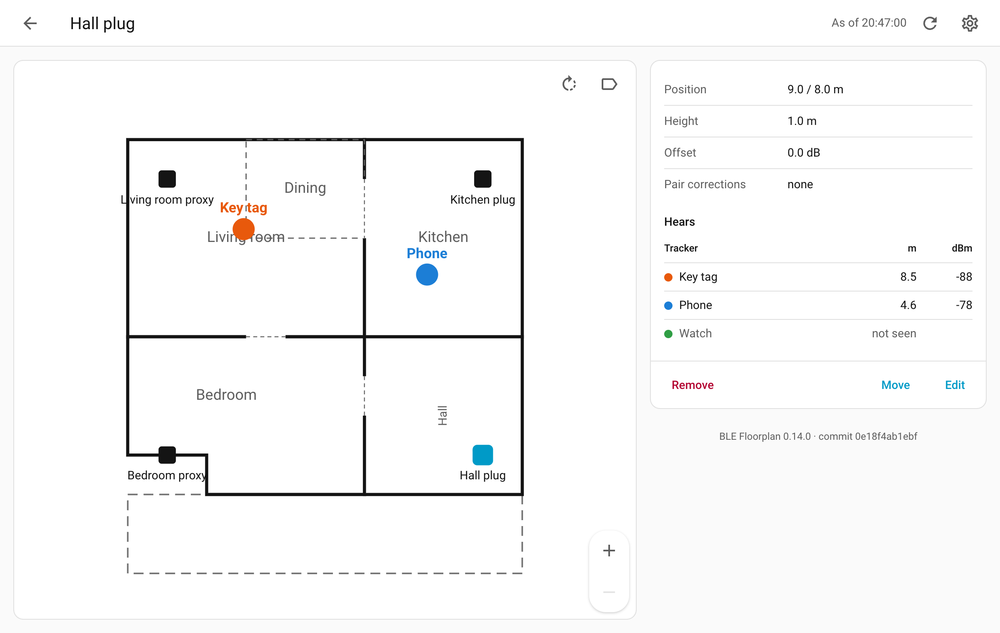

Calibration runs, each a dot on the plan where it was taken:

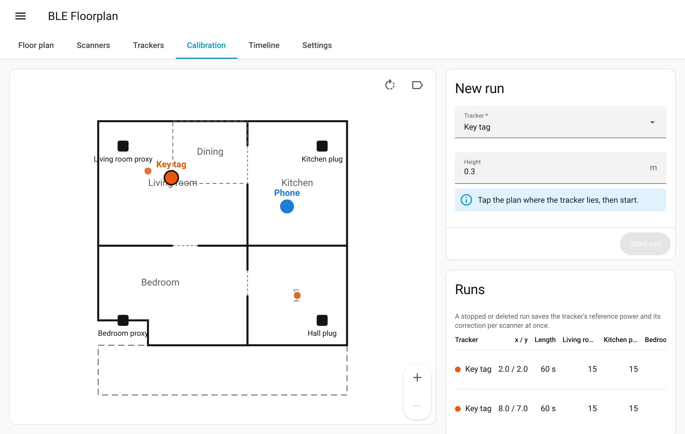

The coverage: the model of the made-up flat, with a probe scanner placed in the middle:

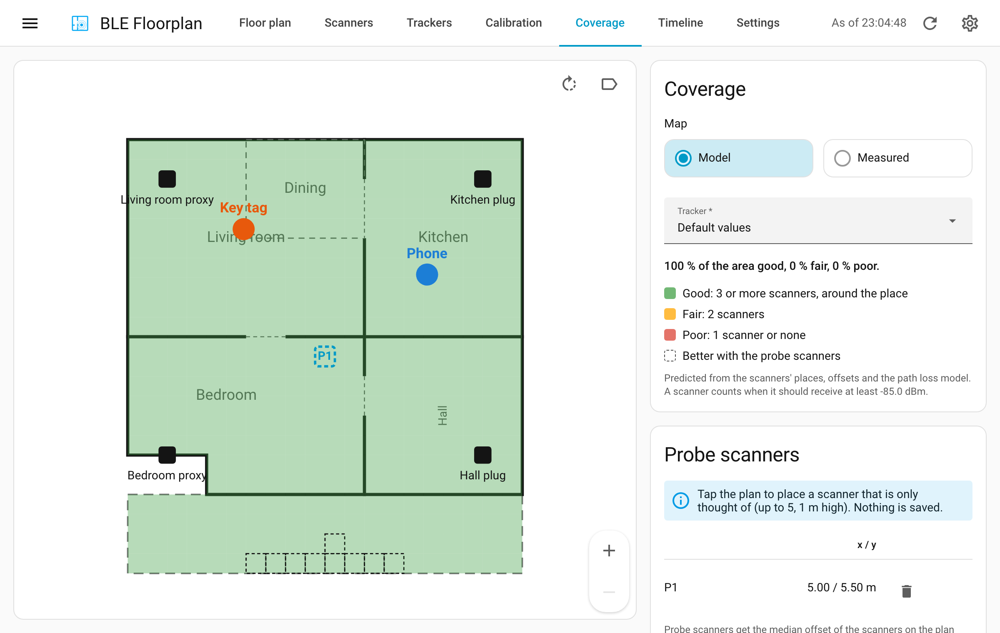

The timeline, dragged back to an earlier moment:

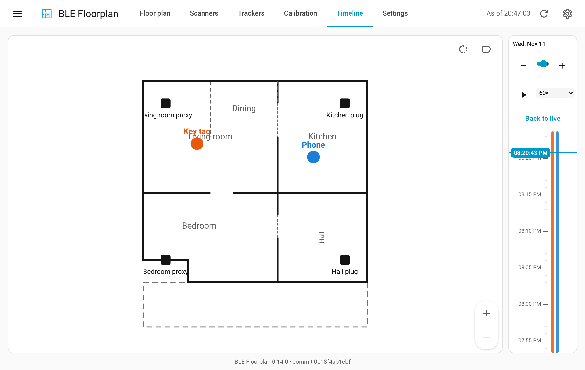

The settings, as Home Assistant's own forms:

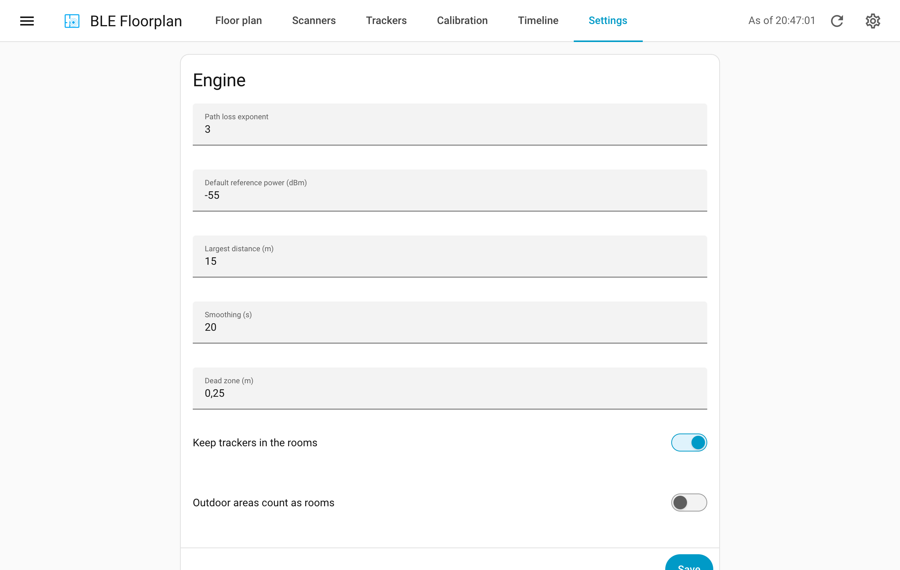

The card on a dashboard, a tracker tapped:

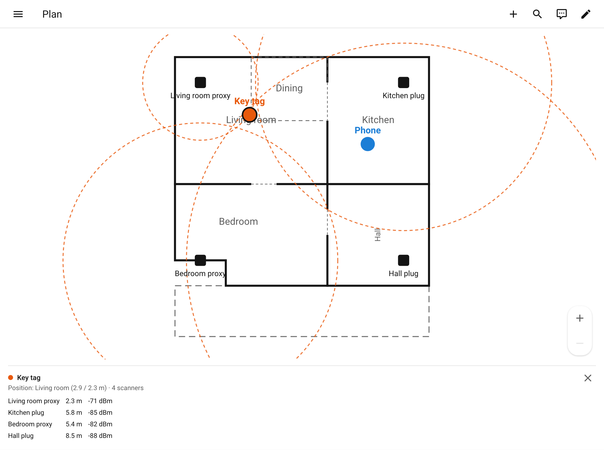

On a phone, in dark mode, with the tabs at the bottom:

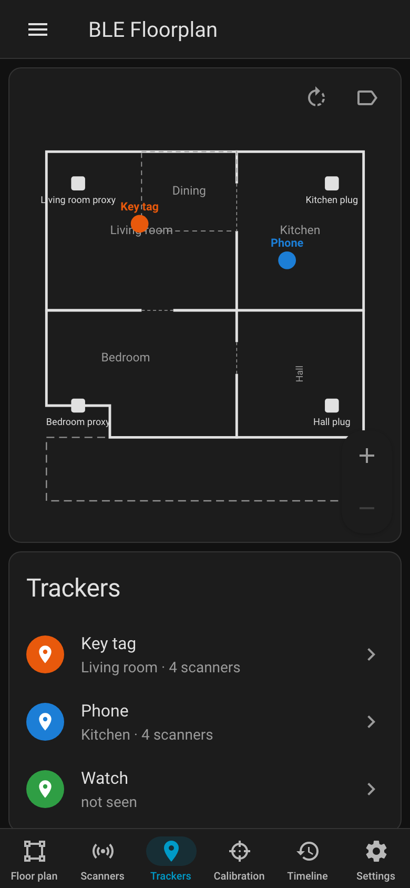

## Design

### Overview

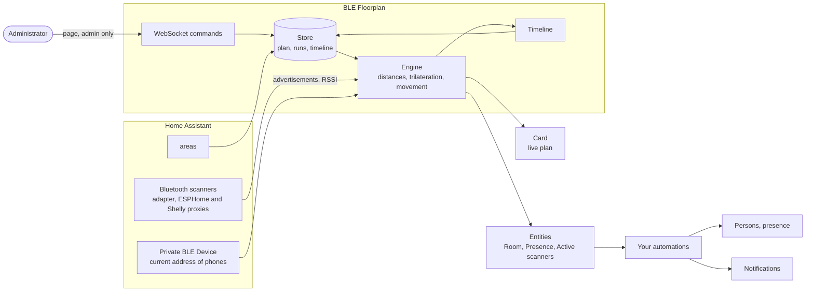

BLE Floorplan reads the advertisements Home Assistant's Bluetooth stack already holds; it opens no connection and polls no device. Once a second the engine computes the positions, updates the entities and the card, and, when days are kept, the timeline.

### Scanners and trackers

- **Every scanner Home Assistant has:** the Bluetooth adapter of the machine, [ESPHome Bluetooth proxies](https://esphome.io/components/bluetooth_proxy.html) and Shelly devices acting as proxies.
- **Phones and watches:** devices set up with [Private BLE Device](https://www.home-assistant.io/integrations/private_ble_device/) change their address every few minutes; BLE Floorplan follows whatever address they currently use, also after their device tracker was renamed. Tags and beacons with a fixed address work as they are.
- **A scanner's page** says what it is (for example *ESP32 · ESPHome*) and keeps its **system details** folded at the bottom: running time, Wi-Fi signal, firmware, last reception, devices in range, scan mode, connection slots and a link to the device. They come from the entities of the device the scanner runs on and from Home Assistant's Bluetooth; what a device does not tell is left out.
- Two scanners that see a tracker give a position; three or more spread over the home give useful ones, four or more let the integration spot a scanner that disagrees with the others.

### How a position comes about

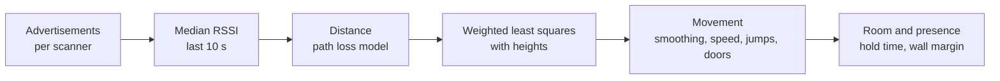

1. **Signals.** Every second, for each tracker, the newest advertisement of every scanner that sees it is read: its signal strength (RSSI) and the time the scanner saw it. Per scanner, the RSSI is the median of the last 10 s; an advertisement older than 30 s counts as not seen.
2. **Distances.** The RSSI becomes a distance with the log-distance path loss model, `d = 10^((ref_power + rssi_offset + pair_offset - rssi) / (10 * attenuation))`, and is projected onto the floor with the heights of scanner and tracker.
3. **Position.** The distances of the scanners within reach go into a weighted Gauss-Newton least-squares fit. Near scanners count more, and a position nearer to a scanner than its measured distance costs less than one farther away, because walls make measured distances rather too long. With four or more scanners, one that the others contradict loses weight.
4. **Movement.** The shown position follows the measured one with smoothing, ignores small moves, confirms jumps, keeps to the top speed and passes walls only through doors: a step through a wall heads for the door of its room that lies best on the way instead.
5. **Room and presence.** The room is the room or zone the shown position lies in, and it changes only after the hold time and well inside the new room. Presence is `home` while any scanner saw the tracker within `away_seconds`.

### The page

**BLE Floorplan** in the sidebar, for administrators only, is built from Home Assistant's own elements. Its tabs are *Floor plan*, *Scanners*, *Trackers*, *Calibration*, *Coverage*, *Timeline* and *Settings*; all but the settings show the plan with the trackers live, and the details next to it. The header is one row: the integration's icon, its name and right after it the tabs. Its right end has on every tab and subpage, as on Home Assistant's own pages, the time the page last got its data (*As of …*, left out on a phone), **Refresh**, which fetches everything the page shows again without reloading it, and the cog, which opens the integration on *Settings → Devices & services*. A scanner or a tracker opens as a subpage with a back arrow. On a phone the plan sits on top and the tabs at the bottom. The version of the integration is at the bottom of the page.

1. **Draw the floor plan** on the *Floor plan* tab. The text field starts with a template of two rooms and a door. Replace it with your rooms in metres, then **Save**. A mistake comes back as a message and nothing is saved. [The floor plan](#the-floor-plan) lists every option.
2. **Add the scanners** on the *Scanners* tab. *Add scanner* offers every Bluetooth scanner Home Assistant knows. Choose one, set the height it is mounted at and **Add**. The page goes straight on to placing it: tap the plan where it is, or drag it, and **Save**.
3. **Add the trackers** on the *Trackers* tab. *Add tracker* offers the Private BLE Devices and the devices with a fixed Bluetooth address. Choose one, give it a name and the height it is usually carried at, then **Add**. Its device and entities appear right away, without a reload; **Remove** takes them away again.
4. **Calibrate.** Put each tracker at a few known places and record a [calibration run](#calibration) each time. Without calibration the positions are rough.
5. **Tune if needed.** The defaults of the [settings](#settings) suit a flat.

A scanner or a tracker is taken off the plan with **Remove** in its details, after a confirmation.

- **Zoom:** pinch with two fingers, turn the mouse wheel or use the buttons in the corner of the plan; zoomed in, drag to move the plan. The zoom stays from tab to tab.
- **Scanners:** what a scanner hears from every tracker, its offset and pair corrections. **Move** places it by tapping or dragging on the plan, **Edit** changes its name and its values.
- **Trackers:** a tracker's distance circles on the plan, the distance and signal strength at every scanner, its height, reference power and pair corrections. **Edit** changes them and its name; the entity ids stay, and the tracker's device takes the new name. **Calibration run** takes it to the calibration with this tracker chosen.
- **Coverage:** where the scanners can place a tracker well and where not, as coloured cells of half a metre over the plan, and a table of the rooms, worst first. See [Coverage](#coverage).
- **Timeline** (once *Days kept* is above 0): a bar next to the plan with newer moments at the top and a bar per tracker where it was seen. Drag it up to go back, tap it to jump to a moment, scroll with the mouse wheel, zoom with − and + from minutes to days. ▶ plays from the moment shown at the speed chosen, *Back to live* returns. The trackers on the plan show where they were then, with their way over the two minutes before.
- The buttons above the plan rotate it and switch the labels of rooms, scanners and trackers, per browser. Hovering a scanner or a tracker shows its readings.

### The card

The card shows the plan with the trackers live, for every user. Pinch with two fingers, Ctrl and the mouse wheel, a trackpad pinch or the buttons in the corner zoom it; zoomed in, drag to move it. Hovering a scanner or a tracker shows its distances and signal strengths; tapping it shows them below the plan, a tracker with its distance circles. The buttons rotate the plan and switch the labels, per browser. Nothing on the card sets anything up: that is the page in the sidebar. While the integration is not loaded, the card says so and tries again every 30 seconds.

```yaml
type: custom:ble-floorplan-card
title: Home            # optional
rotation: 90           # optional default: 0, 90, 180 or 270
show_room_labels: true
show_scanner_labels: true
show_tracker_labels: true
```

The visual editor offers the title; rotation and labels are set on the card itself. The integration adds the card to the dashboard resources by itself and removes it with the integration.

### Calibration

Every scanner hears every tracker a little differently: an adapter may hear a tag as loud as a proxy does, and a phone 15 dB louder. One reference power per tracker and one offset per scanner cannot express that. The calibration therefore records each tracker at known places.

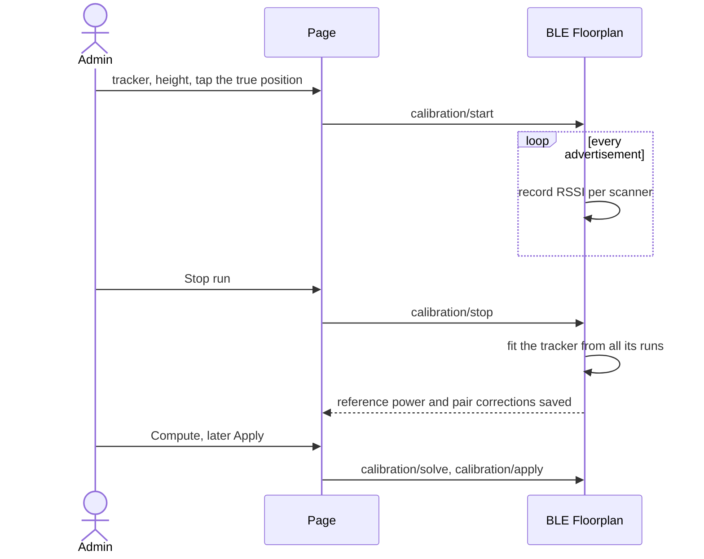

1. On the *Calibration* tab, choose the tracker under *New run* (or tap it on the plan) and set its height for this run. Tap the plan where it lies and **Start run**. Leave it there for a minute or two, then **Stop run**. The stop saves the tracker's reference power and its correction per scanner from all of its runs, and the page shows what was saved and the error before and after. A run that a reload of the integration ends (for example by changing the option or replacing the whole plan) is saved the same way.
2. Repeat at other places and with the other trackers. A scanner needs at least three samples in a run to count. Deleting a run saves the tracker's values from the runs that are left; without a run left, they stay.
3. To adjust the scanners too, **Compute** under *Scanner offsets and exponent*. Fitting the exponent needs runs at different distances from a scanner. The proposal lists the current and the proposed value of every parameter and the error before and after.
4. **Apply** writes the proposal into the plan. The offsets of the scanners and the exponent hold for every tracker, so they change only here.

How a tracker's values follow from its runs: the scanner offsets and the exponent stay as they are. Per scanner, the runs give the tracker's reference power plus the pair's correction; the reference power is the mean of that over the scanners, each scanner counting once, and what a scanner differs from it becomes the pair's correction.

How the fit over all runs works: for each run and scanner, the median signal strength is one observation, and its true distance follows from the positions and heights of the run and the scanner. A least-squares fit over `rssi = ref_power + rssi_offset - 10 * attenuation * log10(distance)` gives the reference power of every tracker and the offset of every scanner, made to average zero. What the fit leaves per pair becomes the pair's correction.

### Coverage

The *Coverage* tab shows two maps, each for one tracker or for all of them:

- **Model:** predicted from the scanners' places and heights, their offsets and pair corrections, the tracker's reference power and height (or the default reference power and 1 m) and the path loss exponent, as the engine computes distances, only backwards. Walls have no term of their own: the exponent and the offsets from the calibration already hold what a wall typically takes. **Probe scanners:** tap the plan to place up to five scanners that are only thought of, 1 m high, with the median offset of the scanners on the plan; the cells they make better are outlined. Nothing is saved.
- **Measured:** what the scanners received where the trackers really were. Every second, a seen tracker adds a sample to its grid cell: how many scanners received it well, how they lay around it, and how far their distance circles missed the raw position. A cell shows once it has 30 seconds of samples; rooms are weighted by time. The measurement is recorded only while the timeline is on and kept as many days; **Start anew** forgets it, for after a scanner moved or came in. The page fetches it again every minute.

A scanner receives a tracker *well* from −85 dBm on. A place is **good** with three such scanners or more that lie around it rather than in a line (HDOP at most 2), **fair** with two, **poor** with one or none. Where a position is poor, it is also less accurate, so the measured map shows the poor places a little blurred.

### Timeline

When days are kept, a point goes into a tracker's track when it is seen again or no longer seen, when its room changes, and when it moved 0.3 m and the last point is 2 s old; a tracker at rest adds nothing. Every day (UTC) is a store of its own that starts with where the trackers were at midnight, written a minute after new points; days older than *Days kept* are deleted, and 0 deletes all of them at once. A stop of Home Assistant ends every track with a gap. A busy tracker adds about 10,000 points a day, some 350 kB.

### Settings

All settings are on the *Settings* tab of the page. Setting a value to 0 switches a rule off where noted.

| Setting | Default | Meaning |
|---|---|---|
| Path loss exponent (`attenuation`) | 3.0 | How fast the signal weakens with distance. |
| Default reference power (`ref_power_default`) | −55 dBm | Signal strength at one metre for trackers without their own value. |
| Largest distance (`max_distance`) | 15 m | Scanners farther away are ignored for the position. |
| Smoothing (`smoothing_seconds`) | 20 s | Time constant of the smoothing of the shown position. |
| Dead zone (`min_move`) | 0.25 m | Smaller moves are ignored. |
| Keep trackers in the rooms (`clamp`) | on | A position outside every room moves to the closest wall. |
| Outdoor areas count as rooms (`clamp_outdoor`) | off | Lets trackers stay on balconies and terraces. |
| Top speed (`max_speed`) | 1.5 m/s | The shown position never moves faster; 0 is off. |
| Jump distance (`jump_distance`) | 2 m | A measured position this far away counts as a jump; 0 is off. |
| Jump confirmation (`jump_confirm_seconds`) | 3 s | A jump is followed only after it stayed that long. |
| Through walls only at doors (`walls`) | on | The shown position passes walls only through openings. |
| Away after (`away_seconds`) | 120 s | Presence turns `not_home` after this long without a sighting. |
| Hold time (`room_hold_seconds`) | 5 s | The room changes only after this long in the new room. |
| Wall margin (`room_margin`) | 0.3 m | ... and at least this far from the new room's walls; 0 is off. |
| Residual (`robust_residual`) | 1 m | With four or more scanners, a scanner the others contradict by more loses weight; 0 is off. |
| Days kept (`history_days`) | 0 | Days the timeline keeps, at most 30; 0 records nothing and deletes what was kept. |

**Settings → Devices & services → BLE Floorplan → Configure** has one option: **Position sensors** (off by default) gives every tracker the sensors *Position X* and *Position Y*, for example for history graphs; unlike the attributes of the room sensor they go into the recorder. Saving reloads the integration.

### The floor plan

The floor plan is edited as YAML on the *Floor plan* tab of the page. Everything is in metres; the origin is the top left corner and y grows downwards. Numbers must be finite.

```yaml
rooms:
  - name: Living room          # a rectangle
    area: living_room          # optional: the area of Home Assistant, by id or name
    x: 0
    y: 0
    w: 6
    h: 5
  - name: Bedroom              # a polygon
    points: [[0, 5], [6, 5], [6, 9], [2, 9], [2, 8], [0, 8]]
  - name: Dining               # a zone inside a room: dashed, and wins when a tracker lies in it
    x: 3
    y: 0
    w: 3
    h: 2.5
    zone: true
  - name: Balcony              # outdoors: dashed, trackers are kept out unless clamp_outdoor is on
    x: 0
    y: 9
    w: 10
    h: 2
    outdoor: true
openings:                      # doors and open passages, as a line on a wall
  - [6, 1, 6, 2.5]
```

Room labels also take `lx`, `ly` (position), `fs` (font size), `rot` (rotation) and `label: false`. Of overlapping rooms the one drawn last wins; zones win over the rooms they lie in. Walls are the outlines of the rooms; a tracker passes them only where an opening lies on them, so add every door and open passage.

A room with `area` gives its *Room* sensor the attribute `area_id`; an area Home Assistant does not know is refused when the plan is saved.

### Privacy

The integration stores the floor plan, the scanners' addresses, the trackers' addresses or device ids, the calibration runs and, when *Days kept* is above 0, the timeline and the measured coverage in Home Assistant's storage. The timeline is a movement profile of the people who carry the trackers; only administrators can read it, and setting *Days kept* to 0 deletes it. The measured coverage holds per tracker and day how long it was in which half-metre cell; it follows the same rules. Every user can see the card, as every user can see the room sensors; users who are no administrators get the plan without addresses, device ids, corrections and runs. It sends nothing anywhere else, and the page and the card talk to Home Assistant only. A test in this repository checks that the code uses no network library, that no real address is in any file and that the images carry no metadata.

## Examples

A person counts as home while a scanner hears their phone: in **Settings → People**, add the tracker *Phone Presence* (`device_tracker.phone_presence`) to the person.

Light in the room the phone is in, through the room's area:

```yaml
automation:
  - alias: Light follows the phone
    triggers:
      - trigger: state
        entity_id: sensor.phone_room
    conditions:
      - condition: template
        value_template: "{{ state_attr('sensor.phone_room', 'area_id') is not none }}"
    actions:
      - action: light.turn_on
        target:
          area_id: "{{ state_attr('sensor.phone_room', 'area_id') }}"
```

A notification when a scanner goes quiet:

```yaml
automation:
  - alias: Bluetooth scanner quiet
    triggers:
      - trigger: numeric_state
        entity_id: sensor.ble_floorplan_active_scanners
        below: 4
        for: "00:05:00"
    actions:
      - action: notify.notify
        data:
          message: >-
            Quiet: {{ state_attr('sensor.ble_floorplan_active_scanners', 'inactive') | join(', ') }}
```

## Known limitations

- Indoor signal strength scatters by 10–20 dB with reflections, bodies and orientation. Positions are rough; rooms are right most of the time when the scanners are spread out and the trackers calibrated.
- A corner that no scanner covers places trackers at the nearest wall.
- Uncalibrated trackers get the scanner offsets only, which fit the calibrated trackers best.
- The *Room* sensor changes only after the hold time, so it suits "who is where" better than switching lights the moment someone walks in; a motion sensor is quicker for that.
- One floor only.

## Troubleshooting

- **A tracker is never seen:** on its subpage, the table shows which scanners hear it. A phone needs its Private BLE Device set up and its device tracker present.
- **A tracker sticks to a wall:** add the door it should pass to `openings`, or the room it is in to the plan.
- **The card says BLE Floorplan is not set up:** the integration is not loaded; the card tries again every 30 seconds.
- **The integration does not start and names a file in `.storage`:** that file cannot be read. BLE Floorplan leaves it as it is; correct or remove it and reload the integration.
- **An old page or card after an update:** reload the page; the Companion app keeps its own cache (*Settings → Companion app → Debugging → Reset frontend cache*).
- **A repair issue says a tracker has no device:** its Private BLE Device was removed. Take the tracker off the plan and add it again with the new device.
- **Something else:** download the diagnostics (**Settings → Devices & services → BLE Floorplan → ⋮ → Download diagnostics**) and attach them to an issue. They show the settings, the scanners and trackers as "Scanner 1", "Tracker 1" with their readings, and no names, addresses, device ids, rooms, areas or timeline.

## Interface

### Entities

Each tracker becomes a device with these entities:

| Entity | Description |
|---|---|
| Room (`sensor`) | The room the tracker is in; a short gap in the readings keeps the last room, so it is unknown once the tracker counts as away or when the room has no name. Attribute: `area_id`. Nothing that changes with every advertisement, so the recorder gets a row per room change only; the position and the distances are on the page and in the timeline. |
| Position X, Position Y (`sensor`, diagnostic) | Only with the option *Position sensors*: the coordinates on the plan in metres, rounded to a decimetre. |
| Presence (`device_tracker`) | `home` while a scanner of the plan saw the tracker within `away_seconds`, `not_home` after that. Right after a start of Home Assistant it stays unknown until the tracker is seen or `away_seconds` passed. |

The integration's own device *BLE Floorplan* carries **Active scanners** (`sensor`): the number of scanners of the plan that received anything within the last minute, with `total` and the names of the active and inactive ones as attributes. Paused scanners count neither way; the attribute `paused` names them.

A scanner or a tracker can be **paused** on its page until it is resumed there, over restarts too: a paused scanner adds nothing to the positions, a paused tracker gets no position and its entities are unavailable. Both are drawn grey on the plan and the card.

### WebSocket commands

The page and the card use these commands; they are open for scripts and tools as well. Commands marked *admins* need an administrator.

| Command | Who | Description |
|---|---|---|
| `ble_floorplan/get_floorplan` | everyone | Returns `floorplan` and `positions`. Users who are no administrators get the plan as the card draws it: rooms, openings, scanners with name and position, trackers with name. |
| `ble_floorplan/subscribe` | everyone | Sends `floorplan`, `positions` and, for administrators, `calibration` and `about` (version, commit of a test deployment) now, then an event for every change. |
| `ble_floorplan/get_layout` | admins | Returns `yaml`: the rooms and openings, a template while the plan has none. |
| `ble_floorplan/set_layout` | admins | `yaml` (at most 200,000 characters): replaces the rooms and openings; scanners, trackers and settings stay. |
| `ble_floorplan/set_floorplan` | admins | `floorplan`: replaces the whole plan and reloads the entry. |
| `ble_floorplan/candidates` | admins | Returns the `scanners` (`source`, `name`) and `trackers` (`device_id` or `address`, `name`) that are not on the plan yet. |
| `ble_floorplan/scanner_system` | admins | `key`: returns the scanner's `model`, `manufacturer`, `integration`, `device_id`, `started` (`started_live` false for the last start known), `signal` (dBm), `firmware`, `firmware_latest` (when an update is available), `last_seen` (s), `in_range` (devices in the last minute), `mode`, `connectable`, `slots`, `slots_free`; null for what is not known. |
| `ble_floorplan/add_scanner` | admins | `source`, optionally `name` and `z`: puts a scanner in the middle of the plan. |
| `ble_floorplan/add_tracker` | admins | `device_id` or `address`, `name`, optionally `height`: adds a tracker. |
| `ble_floorplan/remove_scanner` | admins | `key`: takes a scanner off the plan, with its pair corrections. |
| `ble_floorplan/remove_tracker` | admins | `key`: takes a tracker off the plan, with its pair corrections. |
| `ble_floorplan/set_scanner` | admins | `key` and any of `name` (1 to 80 characters), `x`, `y`, `z`, `rssi_offset`, `paused`, `pair_offsets` (`{tracker: dB}`, null removes a pair). The key stays with a new name. |
| `ble_floorplan/set_tracker` | admins | `key` and any of `name` (1 to 80 characters), `height`, `ref_power` (null for the default), `paused`, `pair_offsets` (`{scanner: dB}`). The key and the entity ids stay with a new name; the device takes it without a reload. |
| `ble_floorplan/set_settings` | admins | `settings`: the values to change; the others stay. |
| `ble_floorplan/calibration/start` | admins | `tracker`, `x`, `y`, optionally `height`: starts a run (one at a time). |
| `ble_floorplan/calibration/stop` | admins | Stops the run and saves the tracker's values; returns the run and `fit` (null when no scanner has three samples). |
| `ble_floorplan/calibration/list` | admins | Returns the runs with their sample counts; `samples: true` adds every sample. |
| `ble_floorplan/calibration/delete` | admins | `run_id`: deletes a run and saves the tracker's values from the runs left; returns the runs and `fit`. |
| `ble_floorplan/calibration/fit` | admins | `tracker`: saves the tracker's values from its runs again and returns the `fit`. |
| `ble_floorplan/calibration/solve` | admins | Optionally `attenuation: true` to fit the exponent too. Returns the proposal; nothing is written. |
| `ble_floorplan/calibration/apply` | admins | `attenuation`, `trackers`, `scanners`, `pairs`, each optional: writes them into the plan. |
| `ble_floorplan/coverage/model` | admins | Optionally `tracker` and `probes` (up to 5 of `{x, y, z}`, z 1 m by default): returns `cells` (`[ix, iy, level, good scanners, HDOP]`, with probes also the level without them), `rooms` (`{name, cells: [poor, fair, good]}`), `cell` (m), `good_rssi`, `max_hdop`, `probe_offset`. Level 0 poor, 1 fair, 2 good. |
| `ble_floorplan/coverage/measured` | admins | Optionally `tracker`: returns `cells` (`[ix, iy, level, mean good scanners, mean miss in m, seconds]`), `rooms` (`{name, level, good, seconds}`), `days` and `recording`. |
| `ble_floorplan/coverage/reset` | admins | Forgets the measured coverage. |
| `ble_floorplan/history` | admins | `day` (`YYYY-MM-DD`, UTC): returns `tracks` (`{tracker: [[unix time, x, y, room], …]}`, x and y null while not seen) and the stored `days`. |

Every number must be finite: NaN and infinity are refused.

### Repairs

A tracker whose Private BLE Device was removed from Home Assistant raises a repair issue; it goes once the device is back or the tracker is off the plan.

### Quality scale

`custom_components/ble_floorplan/quality_scale.yaml` lists every rule of Home Assistant's integration quality scale up to Platinum as done or exempt with a reason; `tests/test_quality_scale.py` checks it.

### Store

`.storage/ble_floorplan.floorplan` (the plan), `.storage/ble_floorplan.calibration` (the runs), `.storage/ble_floorplan.history` and one `.storage/ble_floorplan.history.<day>` per kept day (the timeline), `.storage/ble_floorplan.coverage` (the measured coverage).

## Installation

1. **Settings → Marketplace → Add from link** (top right), enter `https://github.com/n-schilling/ha-ble-floorplan` as GitHub link and add it. Adding a repository by link asks you to connect GitHub once.
2. Install **BLE Floorplan** in the Marketplace and restart Home Assistant.
3. **Settings → Devices & services → Add integration → BLE Floorplan.** There is nothing to fill in.
4. Open **BLE Floorplan** in the sidebar and set up the plan, see [The page](#the-page).
5. Add the card `custom:ble-floorplan-card` to a dashboard, if you want the plan there too.

Requires Home Assistant 2026.11 or later, with the Bluetooth integration. Without the Marketplace, copy `custom_components/ble_floorplan` into the `custom_components` folder of your configuration directory and restart. There are no requirements outside Home Assistant.

### Removal

**Settings → Devices & services → BLE Floorplan → ⋮ → Delete** removes the trackers' devices and entities, the stored plan, the calibration runs, the timeline, the page and the card's dashboard resource. Then remove the integration in the Marketplace and restart.

## Development

```bash
uv venv --python 3.14 && uv pip install -r requirements_test.txt
scripts/check.sh
```

`scripts/check.sh` runs what CI runs: ruff, the changelog and translation checks, mypy, the tests with full coverage, the page checks and hassfest in Docker. The page check is not part of CI: run `scripts/check.sh` before a release that changes the page.

The page checks start a throwaway Home Assistant with a made-up flat, reachable from this machine only. Made-up scanners (`scripts/panel/demo_ble`) hear made-up trackers, so the plan shows them where they are; no Bluetooth radio is touched. The checks drive the page and the card in a headless browser (plan and version, the header row with the icon, the name and the tabs in it, its stamp, Refresh and the cog on every tab and subpage, trackers, subpages, ha-form edits, the confirmation before removing, settings, calibration, timeline, the card, phone width, dark mode, no page and no addresses for non-administrators) and stop Home Assistant again. They need their own environment:

```bash
uv venv --python 3.14 .venv-panel && uv pip install --python .venv-panel/bin/python -r requirements_panel.txt
```

They use an installed Google Chrome, otherwise Playwright's Chromium (`.venv-panel/bin/python -m playwright install chromium`). The pictures in this README come from the same run:

```bash
.venv-panel/bin/python -I scripts/panel/check_panel.py --browser chromium --screenshots docs/screenshots
```

Releases: CI runs on `dev`; once it is green, push that commit to `main`. CI does not run again there: the release workflow checks that CI passed for the commit, then tags the version from `manifest.json` and publishes a GitHub release with its CHANGELOG section; the Marketplace offers it as an update.

For testing on a Home Assistant OS host before a release (copies the files, writes the deployed commit for the page and restarts Home Assistant):

```bash
scripts/deploy.sh <ssh-host>
```

The page shows the version and that commit at the bottom; `-dirty` marks files that differ from it.

## License

Apache License 2.0, see [LICENSE](LICENSE).
